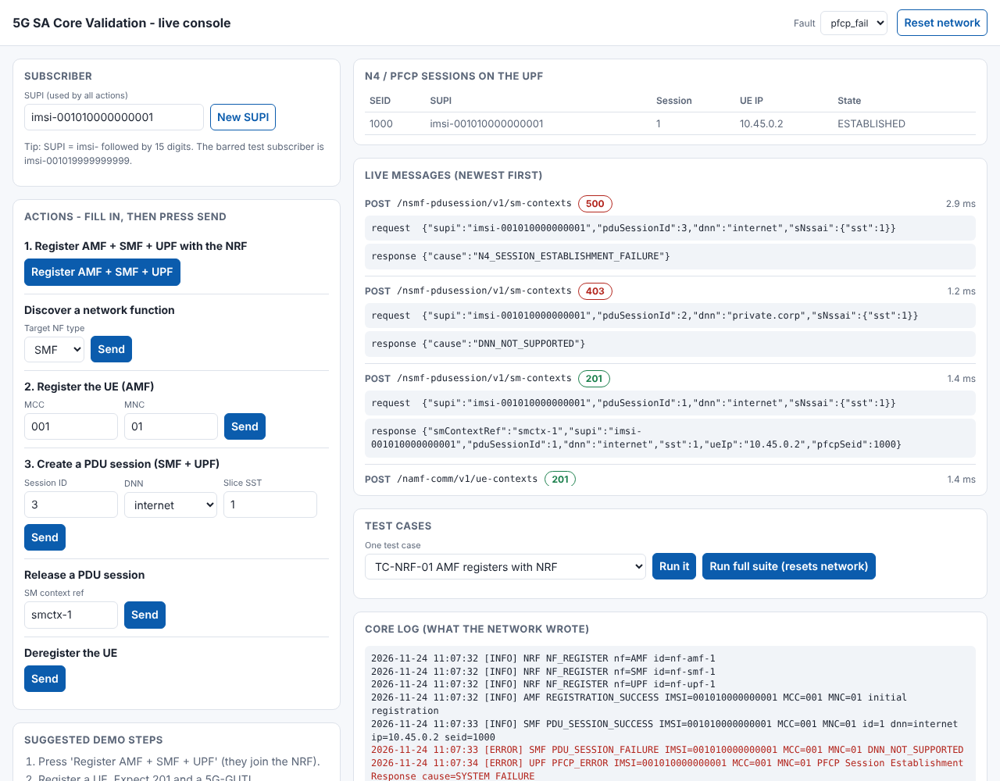
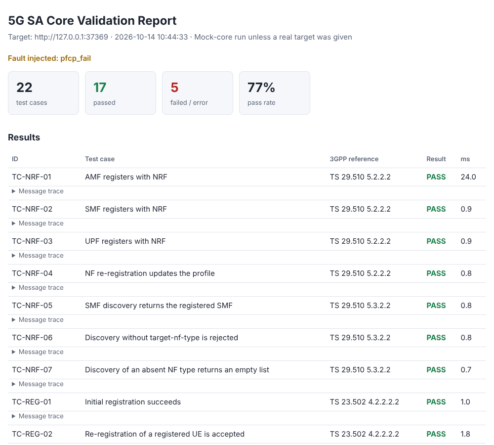

# 5G SA Core Validation

Author: Sweekar Mishra

A Python test-automation framework for 5G Standalone (SA) core procedures, with a live
browser console. It runs 22 test cases, records every request and response, and writes an
HTML report with log analysis. It runs on any laptop with Python 3 and **no installs**,
because it tests a *simulated* core.



## What it validates

| Area | Test cases | 3GPP reference |
|---|---|---|
| NRF: NF registration and discovery | 7 | TS 29.510 |
| AMF: UE registration, re-registration, rejects (bad SUPI, PLMN not allowed, auth failure) | 5 | TS 23.502 4.2.2.2.2 |
| SMF/UPF: PDU session setup and release, N4/PFCP state, rejects (DNN, slice, duplicate ID) | 8 | TS 23.502 4.3.2.2.1 |
| AMF: deregistration releases sessions and N4 state | 2 | TS 23.502 4.2.2.3 |

## Quick start

Requires Python 3.8 or newer.

```bash
python3 run_suite.py                         # run all tests, write reports/report.html
python3 run_suite.py --fault pfcp_fail       # inject an N4 failure and see it reported
python3 live_console.py                      # live console at http://127.0.0.1:8001
```

Windows: double-click `LIVE_DEMO.bat` (live console) or `RUN_DEMO.bat` (automatic run).
Use `python` or `py` instead of `python3` if needed. Mac/Linux: `bash live_demo.sh`.

## Live console

Fill in a subscriber, a DNN or a session ID, press **Send**, and see the response, the
N4 (PFCP) sessions, and what the core wrote to its log. Switch on a fault to break the
network on purpose, run a single test, or run the full suite and watch it fill in.

## Fault injection

`--fault pfcp_fail` makes the UPF reject N4 session establishment. Five PDU-session tests
fail with `expected 201, got 500`, and the log analysis shows `PFCP_ERROR` on the UPF.



## How it works

```
 run_suite.py + test_cases.py  -->  simulated core (mock_core/mock_5gc.py)  -->  core log
          |                                                                          |
   report.html / results.json                                       tools/log_tracker.py
```

| File | Role |
|---|---|
| `mock_core/mock_5gc.py` | Simulated NRF, AMF, SMF and UPF (N4). Rules, state, logging, fault. |
| `test_cases.py` | The 22 test cases. Add one with the `@tc(...)` decorator. |
| `run_suite.py` | Runs the tests, records message traces, writes the report. |
| `tools/log_tracker.py` | Parses the core log with regular expressions. |
| `live_console.py` / `live_console.html` | The interactive console. |

## Scope and limits

- The core is a **simulation**. Payloads are simplified and transport is HTTP/1.1 (a real
  service-based interface uses HTTP/2). On a real core, UE registration arrives as NAS
  signalling from a gNB or simulator, not as a service call.
- All data is synthetic (test PLMN 001/01). No operator or vendor data is included.

## Roadmap

- Connect to Open5GS with UERANSIM on a Linux VM and reuse the same test IDs and report.
- Add PCAP checks for NGAP and PFCP.
- Add more negative and security cases.

## How this was built

Developed with the help of an AI assistant (Claude) as a learning and prototyping aid. The
design, the telecom test scenarios and the review of the results are the author's.

## License

MIT, see [LICENSE](LICENSE).
